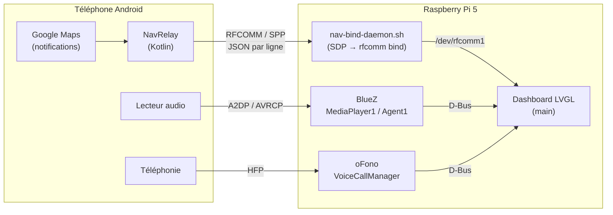

# Mini Dashboard

Tableau de bord automobile pour **Raspberry Pi 5** avec écran rond 1080×1080, écrit en C avec [LVGL](https://lvgl.io) et SDL2.
Il affiche sur un seul écran la navigation Google Maps, la musique et les appels du téléphone, transmis en Bluetooth.

- **Navigation** : prochaine action, distance avant la manœuvre et heure d'arrivée, relayées depuis Google Maps par l'application Android [**NavRelay**](https://github.com/EEmeka33/NavRelay/tree/master).
- **Compteur de vitesse** : à partir du GPS du téléphone.
- **Musique Bluetooth** (A2DP/AVRCP) : titre, artiste, jaquette (API iTunes) et boutons Précédent / Lecture / Suivant.
- **Appels** (HFP via oFono) : affichage de l'appel entrant, boutons Décrocher / Raccrocher.
- **Appairage en un bouton** : le bouton **Pair** rend le Pi visible 3 minutes et accepte l'appairage automatiquement, sans fenêtre sur le Pi.

## Architecture



| Thread du dashboard | Source | Rythme |
|---|---|---|
| Navigation | `/dev/rfcomm1` (une ligne JSON par message) | `poll()` toutes les 500 ms |
| Musique | D-Bus `org.bluez.MediaPlayer1` | 1 s, lecteur recherché toutes les 3 s s'il est absent |
| Jaquette | API iTunes (libcurl) | à chaque changement de piste |
| Appels | D-Bus `org.ofono.VoiceCallManager` | 1 s, modem recherché toutes les 3 s s'il est absent |
| Agent Bluetooth | D-Bus `org.bluez.Agent1` / `Adapter1` | 200 ms |
| Interface | `lv_timer_handler()` | 100 ms |

## Matériel et logiciels

- Raspberry Pi 5 sous **Raspberry Pi OS Bookworm** (64 bits recommandé)
- Écran 1080×1080 (HDMI ou DSI)
- Bluetooth intégré ou clé USB (`hci0`)
- Téléphone Android avec Google Maps et l'application **NavRelay** (dépôt séparé : [EEmeka33/NavRelay](https://github.com/EEmeka33/NavRelay/tree/master), branche `master`)

> Les chemins du code et des services pointent vers `/home/pi5/dashboard`.
> Si le dépôt est cloné ailleurs, crée un lien : `ln -s ~/Mini_Dashboard ~/dashboard`.

## Installation

### 1. Raspberry Pi

```bash
git clone --recursive --branch master https://github.com/EEmeka33/Mini_Dashboard.git
cd Mini_Dashboard
bash SETUP.sh          # 5 à 10 minutes
```

`SETUP.sh` effectue les opérations suivantes :
- installe les paquets (BlueZ, oFono, PulseAudio, SDL2, libdbus, libcurl, json-c, outils de compilation) ;
- écrit un `/etc/bluetooth/main.conf` valide pour BlueZ 5 ;
- installe et démarre le service `nav-bind.service` (liaison RFCOMM vers NavRelay) ;
- ajoute l'utilisateur `pi5` aux groupes `bluetooth` et `dialout` ;
- retire le widget Bluetooth de la barre des tâches, dont la fenêtre « Pairing successful » ferait sortir le dashboard du plein écran.

**Déconnecte-toi puis reconnecte-toi (ou redémarre)** une fois, pour que les nouveaux groupes soient pris en compte.

### 2. Compiler et lancer le dashboard

```bash
cd lv_port_pc_vscode
rm -rf build && mkdir build && cd build
cmake .. && make -j4
cd ../bin && ./main
```

Pour quitter : **Échap** ou **Ctrl+Q** dans l'application, **Ctrl+C** dans le terminal, ou `systemctl --user stop dashboard`.

### 3. Application Android NavRelay

NavRelay a son propre dépôt : <https://github.com/EEmeka33/NavRelay> (branche **`master`**).
Sur le PC qui sert à développer pour Android :

```bash
git clone --branch master https://github.com/EEmeka33/NavRelay.git
```

1. Ouvrir le dossier `NavRelay/` cloné dans Android Studio (`compileSdk` 36, Android 8.0 minimum), brancher le téléphone en USB avec le débogage activé, puis **Run** (ou `./gradlew installDebug`).
2. Dans l'application, appuyer sur **Start**.
3. Accorder **l'accès aux notifications** à NavRelay. L'écran correspondant s'ouvre automatiquement.

L'écran de NavRelay affiche l'état de chaque maillon :

```
1. Notification access: OK
2. Maps listener: bound
3. Bluetooth server: Connected to raspberrypi
4. Messages sent to Pi: 42
```

> Après chaque réinstallation depuis Android Studio, rappuie sur **Start**.
> Si la ligne 2 indique `NOT bound`, désactive puis réactive NavRelay dans *Accès aux notifications*.

## Utilisation

1. Démarrer le Pi : `bluetooth`, `ofono` et `nav-bind` démarrent automatiquement.
2. Lancer le dashboard.
3. **Première fois uniquement** : appuyer sur **Pair** dans le dashboard, puis associer « raspberrypi » depuis les paramètres Bluetooth **du téléphone**. Rien n'est à confirmer sur le Pi. Le téléphone est ensuite reconnu et se reconnecte tout seul.
4. Ouvrir NavRelay, appuyer sur **Start**, puis lancer une navigation dans Google Maps.

L'ordre n'a pas d'importance : le lecteur musique, le modem d'appels et la liaison de navigation sont retrouvés automatiquement, sans relancer le dashboard.

### Format des messages de navigation

NavRelay envoie une ligne JSON par mise à jour :

```json
{
  "timestamp": 1711550400,
  "next_action": "Tournez à droite sur Rue de la Paix",
  "distance_to_next_m": 320,
  "eta": "12 min · 4,5 km · Arrivée à 14:32",
  "speed_kmh": 48.5,
  "lat": 48.8566,
  "lon": 2.3522
}
```

`distance_to_next_m` vaut `-1` quand Maps ne fournit pas de distance ; le dashboard affiche alors `-- m`.

## Structure du dépôt

```
Mini_Dashboard/
├── SETUP.sh                      # Installation complète (à lancer une fois)
├── nav-bind-daemon.sh            # Daemon : lie /dev/rfcomm1 au service NavJsonService du téléphone
├── disable_panel_bluetooth.sh    # Retire (ou --restore) le widget Bluetooth de la barre des tâches
├── bt_setup_audio.sh             # Configuration audio Bluetooth optionnelle
├── bt_make_discoverable.sh       # Ancien script d'appairage (plus utilisé depuis la v4)
├── cover.jpg                     # Cache de la jaquette courante
├── docs/
│   └── DOCUMENTATION_TECHNIQUE_COMPLETE.tex   # Documentation technique détaillée
└── lv_port_pc_vscode/            # Dashboard LVGL
    ├── CMakeLists.txt
    ├── lv_conf.h                 # Configuration LVGL (polices, SDL plein écran, JPEG)
    ├── lvgl/                     # Sources LVGL
    └── src/
        ├── main.c                # UI, threads navigation / musique / jaquette / appels, arrêt propre
        ├── bt_agent.c / .h       # Agent d'appairage BlueZ (bouton Pair)
        ├── speedo_interactive.c  # Compteur de vitesse
        ├── album_art.c           # Téléchargement de la jaquette (iTunes)
        └── hal/hal.c             # Initialisation SDL2 / LVGL
```

L'application Android est dans un dépôt séparé, [EEmeka33/NavRelay](https://github.com/EEmeka33/NavRelay/tree/master) (branche `master`) :

```
NavRelay/
└── app/src/main/java/com/example/navrelay/
    ├── MainActivity.kt               # Bouton Start + écran d'état
    ├── NavServer.kt                  # Serveur Bluetooth RFCOMM (SPP)
    └── MapsNotificationListener.kt   # Lecture des notifications Google Maps
```

## Dépannage rapide

| Symptôme | À vérifier |
|---|---|
| « Waiting for route... » ou rien dans le terminal | L'écran d'état de NavRelay, puis `journalctl -fu nav-bind` (doit afficher `bound /dev/rfcomm1`), puis `cat /dev/rfcomm1` avec le dashboard fermé |
| Distance `-- m` ou action incorrecte | `adb logcat -s NavRelay` pendant une navigation : montre ce que Maps envoie et comment c'est interprété |
| « No MediaPlayer » | Lancer un morceau sur le téléphone ; le dashboard le détecte en moins de 3 s |
| Aucun appel détecté | `systemctl status ofono`, `busctl call org.ofono / org.ofono.Manager GetModems`, messages `[Calls]` dans le terminal |
| Le bouton Pair ne fait rien | Messages `[BT agent]` dans le terminal ; `groups pi5` doit contenir `bluetooth` |
| Une fenêtre Bluetooth du bureau apparaît | `bash disable_panel_bluetooth.sh` (sans sudo) |

Logs utiles :

```bash
journalctl -fu nav-bind.service           # liaison RFCOMM
journalctl --user -fu dashboard.service   # dashboard lancé comme service
journalctl -fu bluetooth.service          # BlueZ
journalctl -fu ofono.service              # oFono
```

## Limitations connues

- **Format des notifications Maps** : NavRelay dépend de la mise en forme des notifications Google Maps, qui n'est pas documentée et peut changer.
- **Accents** : les polices intégrées à LVGL sont en ASCII. Les accents sont donc remplacés à l'affichage (« à » devient « a »).
- **Nom de l'appelant** : avec la plupart des téléphones Android, oFono ne transmet que le numéro.
- **Jaquette** : récupérée par l'API iTunes, ce qui nécessite une connexion Internet.
- **`sdptool`** : utilisé par `nav-bind-daemon.sh`, il est déprécié dans BlueZ 5.

## Documentation

La documentation technique complète se trouve dans [`docs/DOCUMENTATION_TECHNIQUE_COMPLETE.tex`](docs/DOCUMENTATION_TECHNIQUE_COMPLETE.tex), avec sa version compilée [`DOCUMENTATION_TECHNIQUE_COMPLETE.pdf`](DOCUMENTATION_TECHNIQUE_COMPLETE.pdf). Elle couvre l'architecture, la configuration BlueZ / oFono / PipeWire, le daemon RFCOMM, NavRelay, les threads et l'agent d'appairage.
